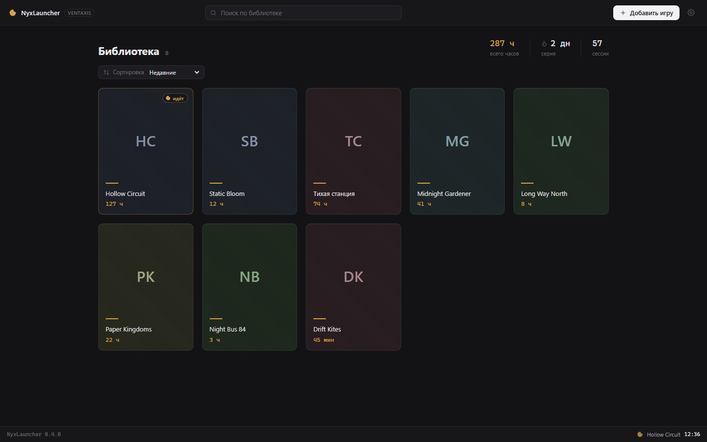
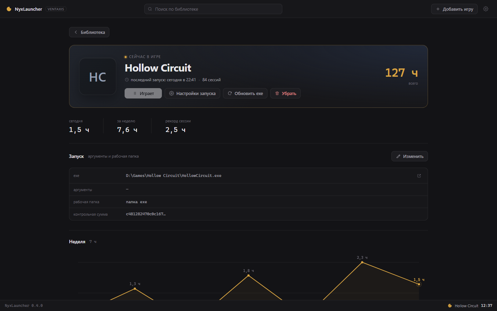
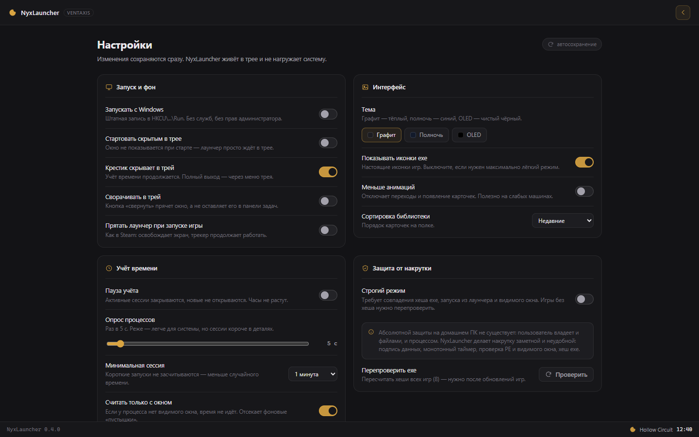
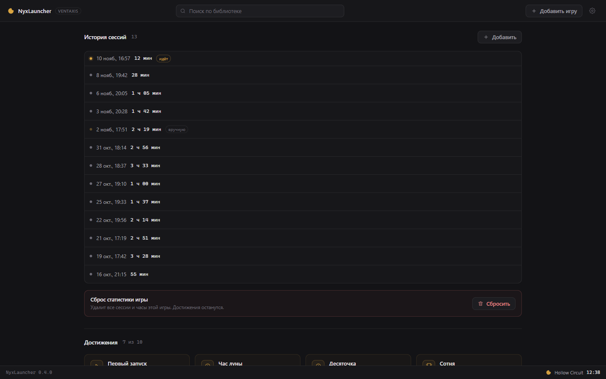

<div align="center">


# NyxLauncher

**Локальный игровой хаб для Windows: библиотека, учёт игрового времени, статистика и достижения. Без магазина, аккаунта и телеметрии.**

[](https://github.com/Ventaxis/nyxlauncher/actions/workflows/build.yml)
[](https://github.com/Ventaxis/nyxlauncher/releases)
[](#совместимость)
[](https://tauri.app)
[](https://react.dev)
[](LICENSE)

</div>

---

NyxLauncher собирает установленные игры в одну библиотеку, считает проведённое
в них время, ведёт историю сессий и выдаёт достижения. Приложение работает
локально: не требует учётной записи, не подключается к сети и не отправляет
данные. Продукт Ventaxis Corp.

<table>
<tr>
<td width="50%"></td>
<td width="50%"></td>
</tr>
<tr>
<td align="center"><sub>Библиотека: карточки с иконками и временем</sub></td>
<td align="center"><sub>Игра: статистика, параметры запуска, график недели</sub></td>
</tr>
<tr>
<td width="50%"></td>
<td width="50%"></td>
</tr>
<tr>
<td align="center"><sub>Настройки: поведение, интерфейс, учёт, защита</sub></td>
<td align="center"><sub>История: сессии, ручные правки, сброс</sub></td>
</tr>
</table>

<sub>На скриншотах — демонстрационная библиотека. Интерфейс на них тот же, что в
установленной программе.</sub>

## Возможности

**Библиотека**

- карточки игр с настоящими иконками исполняемых файлов;
- поиск, сортировка по недавним, названию, часам и дате добавления;
- отдельная страница игры: время, серии, рекорд сессии, график недели,
  достижения.

**Учёт времени**

- фоновый трекер определяет запущенные игры и ведёт сессии посекундно;
- длительность считается монотонным таймером, перевод системных часов не влияет;
- фильтры: минимальная длительность сессии, обязательное видимое окно,
  пауза учёта;
- история сессий с возможностью добавить задним числом, удалить и сбросить
  статистику игры.

**Фоновая работа**

- значок в области уведомлений с меню «Открыть», «Пауза учёта», «Выход»;
- автозапуск с Windows через `HKCU\Software\Microsoft\Windows\CurrentVersion\Run`
  без прав администратора;
- скрытый старт, закрытие в трей, сворачивание в трей, скрытие при запуске игры.

**Запуск**

- аргументы командной строки и рабочая папка на каждую игру;
- пересчёт хеша и иконки после обновления игры;
- запуск напрямую из карточки игры.

**Интерфейс**

- три темы: графит, полночь, OLED;
- режим уменьшенных анимаций;
- русскоязычный интерфейс, размеры окна от 860×600.

**Данные**

- подпись всех файлов состояния (HMAC-SHA256);
- экспорт и импорт подписанной резервной копии;
- предупреждение при обнаружении изменённых файлов.

## Установка

### Установщик

1. Откройте раздел [Releases](https://github.com/Ventaxis/nyxlauncher/releases).
2. Скачайте `NyxLauncher_0.4.0_x64-setup.exe` и `SHA256SUMS.txt`.
3. Сверьте хеш (команда ниже) и запустите установщик.

```powershell
Get-FileHash .\NyxLauncher_0.4.0_x64-setup.exe -Algorithm SHA256
Get-Content .\SHA256SUMS.txt
```

Установщик не подписан сертификатом Authenticode, поэтому SmartScreen может
показать предупреждение «Неизвестный издатель». Это ожидаемо для бесплатного
проекта без коммерческого сертификата: проверяйте контрольную сумму и
скачивайте файлы только из официального раздела Releases.

### Переносная версия

Файл `nyxlauncher.exe` из того же релиза работает без установки. Данные
хранятся в профиле пользователя, поэтому перенос exe не удаляет библиотеку.

### Требования

- Windows 10 или 11, x64;
- Microsoft Edge WebView2 Runtime (в Windows 11 уже установлен; в Windows 10
  обычно присутствует вместе с Edge);
- около 10 МБ на диске для переносной версии.

## Первый запуск

1. Нажмите «Добавить игру» и выберите исполняемый файл игры.
2. При необходимости задайте аргументы запуска и рабочую папку.
3. Включите автозапуск и скрытый старт в настройках, если нужен фоновый режим.

Приложение проверяет выбранный файл: заголовок PE, размер, имя и расположение.
Системные утилиты, файлы из каталога Windows и сам лаунчер отклоняются.

## Настройки

| Раздел | Параметр | Действие |
| --- | --- | --- |
| Запуск и фон | Запускать с Windows | запись в `HKCU\...\Run` с аргументом `--minimized` |
| | Стартовать скрытым в трее | окно не показывается при старте |
| | Крестик скрывает в трей | закрытие окна не завершает процесс |
| | Сворачивать в трей | кнопка «свернуть» прячет окно |
| | Прятать лаунчер при запуске игры | окно скрывается после старта игры |
| Интерфейс | Тема | графит, полночь, OLED |
| | Показывать иконки exe | отключение снижает нагрузку на слабых машинах |
| | Меньше анимаций | отключает переходы и появление карточек |
| | Сортировка библиотеки | недавние, название, часы, добавленные |
| Учёт времени | Пауза учёта | активные сессии закрываются, новые не открываются |
| | Опрос процессов | интервал от 2 до 60 секунд |
| | Минимальная сессия | короткие запуски не засчитываются |
| | Считать только с окном | отсекает фоновые процессы без видимого окна |
| | Учитывать прямой запуск | учёт игр, запущенных не через лаунчер |
| Защита | Строгий режим | требует совпадения хеша и запуска из лаунчера |
| | Перепроверить exe | пересчёт хешей всех игр библиотеки |
| Данные | Папка данных | открыть каталог в проводнике |
| | Резервная копия | экспорт и импорт подписанного файла |
| | Сбросить всё | удаляет статистику и достижения, игры остаются |

## Данные и конфиденциальность

Всё хранится в `%APPDATA%\corp.ventaxis.nyxlauncher`:

| Файл | Содержимое |
| --- | --- |
| `games.json` | библиотека: пути, аргументы, рабочая папка, SHA-256 exe |
| `sessions.json` | сессии: начало, конец, длительность, признак ручной правки |
| `achievements.json` | условия достижений и даты открытия |
| `settings.json` | настройки |
| `meta.json` | идентификатор установки, время последней активности |
| `secret.bin` | локальный ключ HMAC |
| `icons/` | кэш иконок |

Приложение не содержит сетевого клиента, не собирает телеметрию и не имеет
учётных записей. Полное описание — [docs/legal/PRIVACY.md](docs/legal/PRIVACY.md).

## Целостность данных и учёт времени

Файлы состояния подписаны HMAC-SHA256. Изменение файла вне программы
обнаруживается при следующей загрузке: файл сохраняется как `*.tampered.bak`,
а в интерфейсе появляется предупреждение.

Дополнительно проверяются исполняемые файлы: заголовок PE, размер, имя,
расположение, SHA-256. Строгий режим засчитывает время только для процесса,
запущенного лаунчером, с совпадающим хешем и видимым окном.

**Ограничение, о котором важно сказать прямо.** Локальный учёт времени нельзя
защитить абсолютно: пользователь владеет и файлами, и ключом, и процессом.
Реализованные механизмы делают подмену заметной и неудобной, но не невозможной.
Приложение не является античит-системой, не внедряется в процессы игр и не
обходит защиты. Ответственность за соблюдение правил игр и античит-систем несёт
пользователь. Подробнее — [SECURITY.md](SECURITY.md).

## Сборка из исходников

Требуется Windows 10/11 x64, Node.js 22+, Rust stable (MSVC) и Visual Studio
Build Tools с компонентом «Разработка классических приложений на C++».

```powershell
npm ci
npm run build
cargo test --manifest-path src-tauri/Cargo.toml
npx tauri build
```

Результат: `src-tauri/target/release/nyxlauncher.exe` и установщик в
`src-tauri/target/release/bundle/nsis/`.

## Архитектура

```text
ui/                      React 19 + Vite: библиотека, страница игры, настройки
src-tauri/
  src/lib.rs             состояние, команды, трекер, трей, автозапуск
  src/engine.rs          статистика и достижения — 19 тестов
  src/integrity.rs       подпись JSON, SHA-256 файлов — 6 тестов
  src/settings.rs        настройки, HKCU\...\Run — 3 теста
  src/winutil.rs         проверка exe, видимое окно, иконки — 4 теста
  src/store.rs           атомарная запись JSON — 3 теста
  achievements.json      достижения как данные
.github/workflows/       CI: тесты, сборка, публикация релиза
docs/                    архитектура, юридические документы, скриншоты
```

Подробное описание — [docs/ARCHITECTURE.md](docs/ARCHITECTURE.md).

## Тесты и непрерывная интеграция

35 модульных тестов покрывают движок статистики и достижений, подпись данных,
проверку исполняемых файлов, настройки и хранилище.

```powershell
cargo test --manifest-path src-tauri/Cargo.toml
```

GitHub Actions на каждый пуш в `main` запускает тесты, собирает exe и
NSIS-установщик. Тег `v*` публикует релиз с установщиком, переносным exe и
файлом `SHA256SUMS.txt`.

## Совместимость

- **Поддерживается:** Windows 10 21H2 и новее, Windows 11, архитектура x64.
- **Не поддерживается:** Windows 7/8, ARM64, Linux и macOS — приложение
  использует Win32 API, реестр и WebView2.
- **Игры с собственным лаунчером.** Если игра требует запуска через собственный
  клиент с проверкой целостности, запускайте её этим клиентом: NyxLauncher
  засчитает время, если включён учёт прямого запуска.
- **Античит-системы.** Приложение не вмешивается в процессы игр, но решение о
  допустимости сторонних программ остаётся за издателем игры.

## Документация

| Документ | Содержание |
| --- | --- |
| [CHANGELOG.md](CHANGELOG.md) | история версий |
| [docs/ARCHITECTURE.md](docs/ARCHITECTURE.md) | устройство приложения |
| [SECURITY.md](SECURITY.md) | политика безопасности и модель угроз |
| [docs/legal/PRIVACY.md](docs/legal/PRIVACY.md) | обработка данных |
| [docs/legal/TRADEMARKS.md](docs/legal/TRADEMARKS.md) | наименования и логотипы |
| [THIRD_PARTY_NOTICES.md](THIRD_PARTY_NOTICES.md) | сторонние компоненты |
| [CONTRIBUTING.md](CONTRIBUTING.md) | правила участия |
| [CODE_OF_CONDUCT.md](CODE_OF_CONDUCT.md) | кодекс поведения |

## Лицензия

NyxLauncher — проприетарное программное обеспечение. Использование разрешено
в личных некоммерческих целях на условиях [LICENSE](LICENSE). Распространение,
модификация и обратная разработка ограничены. Программа предоставляется «как
есть», без гарантий; ответственность ограничена в соответствии с разделом 7
лицензии.

Сторонние библиотеки распространяются на условиях собственных лицензий —
см. [THIRD_PARTY_NOTICES.md](THIRD_PARTY_NOTICES.md).

## Контакты

- Ошибки и предложения: [Issues](https://github.com/Ventaxis/nyxlauncher/issues)
- Уязвимости: [Security Advisories](https://github.com/Ventaxis/nyxlauncher/security/advisories/new)
- Релизы: [Releases](https://github.com/Ventaxis/nyxlauncher/releases)

---

<sub>© 2026 Ventaxis Corp. Все права защищены. Windows и Microsoft являются
товарными знаками Microsoft Corporation. Steam и Valve — товарными знаками
Valve Corporation. Проект не связан с указанными компаниями.</sub>
